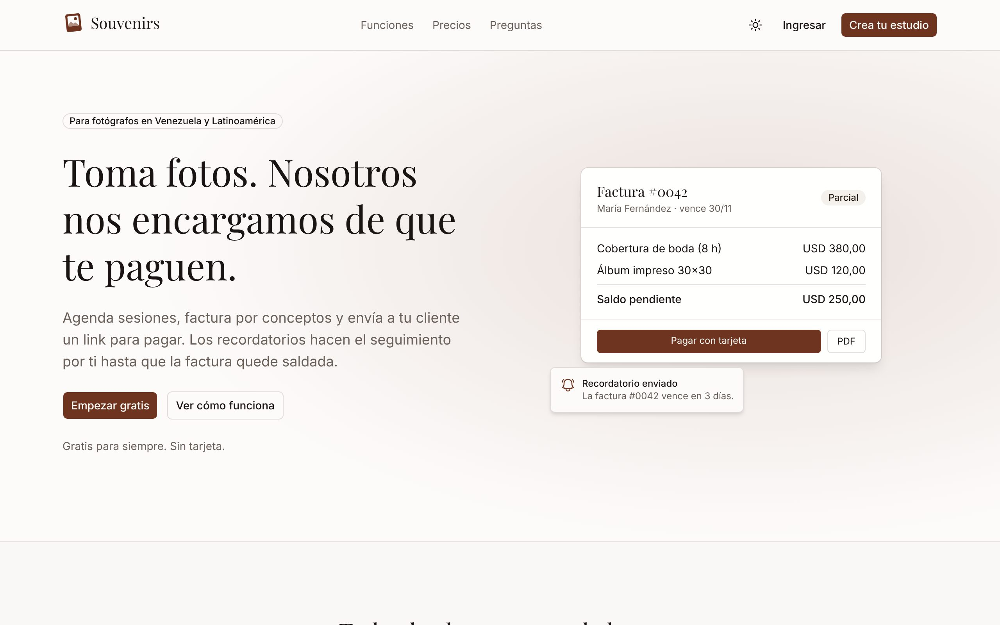
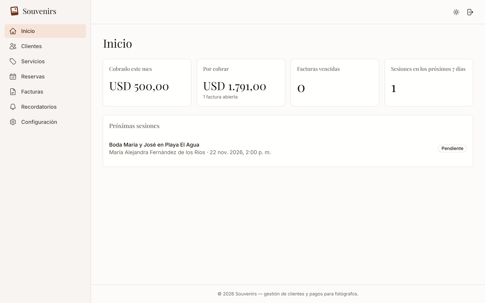
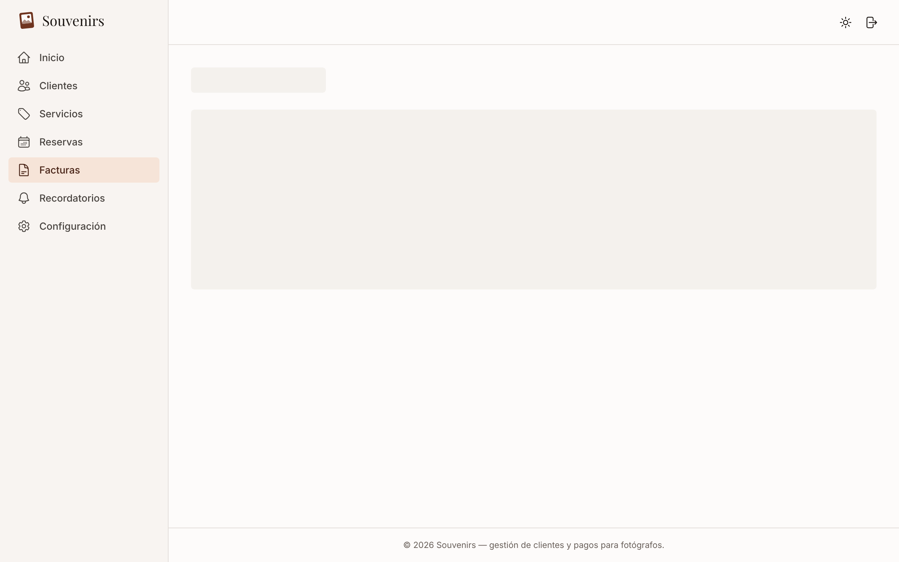
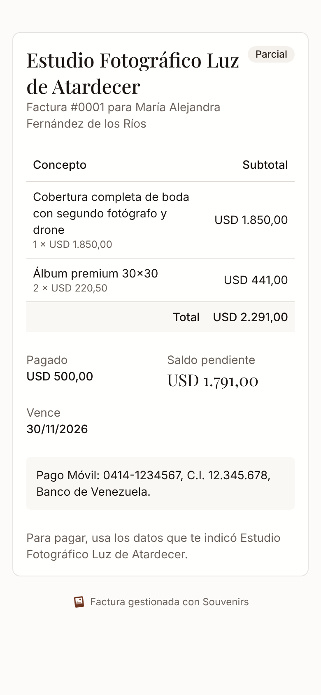

<div align="center">


# Souvenirs

### Clientes, reservas y cobros para fotógrafos

Agenda sesiones, factura por conceptos, envía a tu cliente un link de pago y deja que los recordatorios hagan el seguimiento hasta que la factura quede saldada. SaaS multi-tenant pensado para cobrar en Venezuela y Latinoamérica.

[](https://github.com/Suggus1899/Souvenirs/actions/workflows/ci.yml)

</div>

<p align="center">
  
</p>

---

## 🛠️ Tech Stack

Todo el monorepo usa TypeScript estricto. La API expone REST con NestJS; la web es un panel Next.js con App Router que actúa de BFF (el JWT vive en una cookie httpOnly y nunca llega al navegador); la app móvil usa Expo.

<table align="center">
  <tr>
    <th colspan="5" align="center"><sub><b>Backend</b></sub></th>
  </tr>
  <tr>
    <td align="center" width="120">
      <br/>
      <sub><b>NestJS 11</b></sub><br/>
      <sub>API REST</sub>
    </td>
    <td align="center" width="120">
      <br/>
      <sub><b>Prisma 6</b></sub><br/>
      <sub>ORM y migraciones</sub>
    </td>
    <td align="center" width="120">
      <br/>
      <sub><b>PostgreSQL 16</b></sub><br/>
      <sub>Row Level Security</sub>
    </td>
    <td align="center" width="120">
      <br/>
      <sub><b>Stripe Connect</b></sub><br/>
      <sub>Cobros y suscripción</sub>
    </td>
    <td align="center" width="120">
      <br/>
      <sub><b>Resend</b></sub><br/>
      <sub>Emails</sub>
    </td>
  </tr>
  <tr>
    <th colspan="5" align="center"><sub><b>Frontend</b></sub></th>
  </tr>
  <tr>
    <td align="center" width="120">
      <br/>
      <sub><b>Next.js 16</b></sub><br/>
      <sub>App Router + BFF</sub>
    </td>
    <td align="center" width="120">
      <br/>
      <sub><b>React 19</b></sub><br/>
      <sub>Server Components</sub>
    </td>
    <td align="center" width="120">
      <br/>
      <sub><b>Tailwind v4</b></sub><br/>
      <sub>Estilos</sub>
    </td>
    <td align="center" width="120">
      <br/>
      <sub><b>shadcn/ui</b></sub><br/>
      <sub>Componentes</sub>
    </td>
    <td align="center" width="120">
      <br/>
      <sub><b>Expo 57</b></sub><br/>
      <sub>App móvil</sub>
    </td>
  </tr>
  <tr>
    <th colspan="5" align="center"><sub><b>Tooling</b></sub></th>
  </tr>
  <tr>
    <td align="center" width="120">
      <br/>
      <sub><b>TypeScript 5</b></sub><br/>
      <sub>Tipado estricto</sub>
    </td>
    <td align="center" width="120">
      <br/>
      <sub><b>pnpm</b></sub><br/>
      <sub>Workspaces</sub>
    </td>
    <td align="center" width="120">
      <br/>
      <sub><b>Jest</b></sub><br/>
      <sub>Unit + e2e</sub>
    </td>
    <td align="center" width="120">
      <br/>
      <sub><b>Docker</b></sub><br/>
      <sub>Postgres local</sub>
    </td>
    <td align="center" width="120">
      <br/>
      <sub><b>GitHub Actions</b></sub><br/>
      <sub>CI</sub>
    </td>
  </tr>
</table>

## 📸 Capturas

| Panel | Factura | Lo que ve el cliente |
|---|---|---|
|  |  |  |

## 📐 Arquitectura

```
+------------------------+        +------------------------+
| Navegador              |        | App móvil (Expo)       |
| panel del fotógrafo    |        | reservas, facturas,    |
| + página pública /pay  |        | pagos y push           |
+------------------------+        +------------------------+
            | cookie httpOnly                 | Bearer JWT
            v                                 |
+------------------------+                    |
| Next.js (web)          |                    |
| Server Components +    |                    |
| proxy /api/proxy (BFF) |                    |
+------------------------+                    |
            | Bearer JWT                      |
            v                                 v
+---------------------------------------------------------+
| API NestJS                                              |
| auth · clients · services · bookings · invoices ·       |
| payments · reminders · team · dashboard · public        |
| crons: vencidas (1 h) · recordatorios (5 min) · tasa    |
+---------------------------------------------------------+
     | rol app_runtime (RLS)    |              |
     v                          v              v
+-----------------+   +----------------+  +------------------+
| PostgreSQL 16   |   | Stripe Connect |  | Resend · Expo    |
| Row Level Sec.  |   | + webhooks     |  | email · push     |
+-----------------+   +----------------+  +------------------+
```

El aislamiento entre estudios es doble: cada query filtra por `tenantId` y, además, Postgres aplica **Row Level Security**. La API se conecta con un rol sin privilegios de dueño (`app_runtime`) y fija `app.tenant_id` en cada transacción, así que un bug en el código no puede leer datos de otro estudio.

## 📱 Aplicaciones

| Aplicación | Carpeta | Local | Producción |
|---|---|---|---|
| 🖥️ **API** | `apps/api` | `http://localhost:3000` (docs en `/docs`) | VPS + pm2 (`ecosystem.config.js`) |
| 🌐 **Web** | `apps/web` | `http://localhost:3001` | VPS + pm2 detrás de Nginx |
| 📱 **Mobile** | `apps/mobile` | Expo Go / `expo start --web` | EAS / tiendas |
| 🗄️ **Base de datos** | `docker-compose.yml` | `postgresql://localhost:5432` | PostgreSQL 16 gestionado o en el VPS |

## 📦 Estructura del Proyecto

```
Souvenirs/
├── apps/
│   ├── api/                    NestJS: módulos por dominio, Prisma, tests unit y e2e
│   │   ├── prisma/             Schema, migraciones y rls-setup.sql (rol app_runtime)
│   │   ├── src/                auth, tenants, users, clients, services, bookings, invoices,
│   │   │                       payments, reminders, dashboard, public, webhooks, health…
│   │   └── test/               e2e contra Postgres real (incluye pruebas de RLS)
│   ├── web/                    Next.js: panel, landing, página pública /pay/[token]
│   └── mobile/                 Expo Router: reservas, facturas, pagos, notificaciones
├── packages/shared/            Tipos TypeScript compartidos entre web y mobile
├── docker/                     Script de inicialización de Postgres (rol RLS)
├── docs/screenshots/           Capturas usadas en este README
├── .github/workflows/ci.yml    Lint, tipos, tests unit + e2e y builds
├── docker-compose.yml          Postgres 16 para desarrollo
├── ecosystem.config.js         Procesos pm2 de producción
└── DEPLOY.md                   Guía de despliegue (VPS, Nginx, TLS, Stripe)
```

## 🚀 Quick Start

### Requisitos

| Herramienta | Versión | Uso |
|---|---|---|
| Node.js | 20 o superior | Todo el monorepo |
| pnpm | 10 o superior | Workspaces |
| Docker | Opcional | Postgres local con `docker compose` |
| PostgreSQL | 16 | Si no usas Docker |

### 1. Instalar y levantar la base de datos

```bash
pnpm install
pnpm db:up                     # Postgres 16 + rol app_runtime (solo la primera vez crea el rol)
```

Sin Docker: crea la base `souvenirs` y ejecuta una vez el setup de RLS antes de migrar:

```bash
psql "$DATABASE_URL" -v runtime_password=runtime -f apps/api/prisma/rls-setup.sql
```

### 2. Variables de entorno

```bash
cp apps/api/.env.example apps/api/.env          # ya apunta al Postgres del compose
cp apps/web/.env.example apps/web/.env.local
cp apps/mobile/.env.example apps/mobile/.env
```

### 3. Migrar y arrancar

```bash
pnpm db:migrate
pnpm dev:api                   # http://localhost:3000  ·  Swagger en /docs
pnpm dev:web                   # http://localhost:3001
pnpm dev:mobile                # Expo (opcional)
```

Para probar cobros con Stripe en local, reenvía los webhooks con `stripe listen --forward-to localhost:3000/webhooks/stripe` y copia el secreto que imprime a `STRIPE_WEBHOOK_SECRET`.

## ✨ Funcionalidades

| Área | Qué incluye |
|---|---|
| 🧾 **Facturas** | Numeración correlativa por estudio, conceptos con cantidad y precio, notas, moneda, vencimiento, vista imprimible para PDF y exportación a CSV. |
| 🔗 **Cobro al cliente** | Al enviar una factura, el cliente recibe un email con un link privado (`/pay/…`) para ver el detalle y pagar con tarjeta vía Stripe, sin crear cuenta. |
| 💵 **Pagos** | Pagos manuales (efectivo USD/Bs, transferencia, Pago Móvil, Zelle, Binance/USDT) y de Stripe registrados por webhook. El estado de la factura se recalcula solo. |
| 🔔 **Recordatorios** | Email al cliente y push al estudio antes y después del vencimiento; push un día antes de cada sesión. Se cancelan solos al pagar o cancelar. |
| 📅 **Reservas** | Lista y calendario mensual, detección de solapamientos con opción de guardar igual, vínculo con servicios y clientes. |
| 👥 **Clientes** | Búsqueda, ficha con saldo pendiente por moneda, historial de facturas y sesiones. |
| 📊 **Panel** | Cobrado en el mes y pendiente por moneda, facturas vencidas y próximas sesiones. |
| 🤝 **Equipo** | El dueño invita asistentes por email; quitar a un miembro le revoca el acceso al instante. |
| 💱 **Venezuela** | Equivalente en bolívares a tasa oficial (BCV) y paralela, actualizado cada 5 horas. |
| 📱 **App móvil** | Reservas próximas, facturas pendientes, registro de pagos y notificaciones que abren la factura correspondiente. |

## 📊 Reglas de Negocio

### Facturas

| Regla | Valor |
|---|---|
| Estados | `DRAFT` → `SENT` → `PARTIAL` / `OVERDUE` → `PAID`, o `CANCELLED` |
| Edición | Solo en borrador; con conceptos, el total se calcula a partir de ellos |
| Vencida | Una factura `SENT`/`PARTIAL` pasa a `OVERDUE` cuando termina el día de vencimiento (cron cada hora) |
| Pago manual | No puede superar el saldo pendiente |
| Pago con Stripe | Se cobra el saldo pendiente, no el total; idempotente por *payment intent* |
| Plan gratis | Hasta 5 facturas por mes; Pro ($15/mes) las hace ilimitadas |

### Recordatorios

| Regla | Valor |
|---|---|
| Días por defecto | 3 antes, el día del vencimiento y 3 después (configurable entre −30 y +30, máx. 6) |
| Destinatarios | Push al estudio; email al cliente (o al estudio el día del vencimiento si el cliente no tiene email) |
| Reservas | Push al estudio 24 h antes; se reprograma al editar y se cancela al borrar o cancelar |
| Envío | Cron cada 5 min; cada recordatorio se reclama de forma atómica, así varias instancias nunca lo envían dos veces |

### Cuentas y seguridad

| Regla | Valor |
|---|---|
| Roles | `OWNER` (plan, Stripe, equipo, preferencias) y `ASSISTANT` (operación diaria) |
| Sesión | JWT de 24 h (`JWT_EXPIRES_IN_SECONDS`); en cada request se comprueba que el usuario siga existiendo |
| Rate limit | 100 req/min general; 5/min en login, registro y recuperación; 20/min en endpoints públicos |
| Recuperación | Enlace de un solo uso, válido 1 h (invitaciones: 3 días); solo se guarda el hash SHA-256 |
| Link público | Token aleatorio de 192 bits; los borradores no son visibles; la página no se indexa |

## 🔧 Variables de Entorno

Las plantillas están en cada app (`.env.example`). Nunca subas un `.env` a git.

### API (`apps/api/.env`)

| Variable | Producción | Descripción |
|---|---|---|
| `DATABASE_URL` | Sí | Conexión con el rol dueño de las tablas; solo para migraciones y tareas de sistema. |
| `DATABASE_URL_RUNTIME` | Sí | Conexión con el rol `app_runtime`, sujeto a RLS. |
| `JWT_SECRET` | Sí | Firma de los tokens. Usa un valor largo y aleatorio. |
| `JWT_EXPIRES_IN_SECONDS` | No | Duración de la sesión en segundos. Por defecto `86400`. |
| `STRIPE_SECRET_KEY` | Sí | Clave secreta de Stripe. |
| `STRIPE_WEBHOOK_SECRET` | Sí | Secreto del endpoint `/webhooks/stripe`. |
| `STRIPE_PRO_PRICE_ID` | Sí | Precio recurrente del plan Pro. |
| `WEB_APP_URL` | Sí | URL pública del panel; se usa en emails y redirecciones de Stripe. |
| `RESEND_API_KEY` / `RESEND_FROM_EMAIL` | Sí | Envío de emails. |
| `CORS_ORIGIN` | Sí | Orígenes permitidos, separados por comas. La API no arranca en producción sin él. |

### Web (`apps/web/.env.local`) y Mobile (`apps/mobile/.env`)

| Variable | Descripción |
|---|---|
| `API_URL` | URL de la API para el servidor de Next. |
| `NEXT_PUBLIC_TIME_ZONE` | Zona horaria en la que se muestran las fechas. Por defecto `America/Caracas`. |
| `EXPO_PUBLIC_API_URL` | URL de la API para la app móvil. |

## 🧪 Testing & CI

```bash
pnpm lint                      # ESLint en api, web y mobile
pnpm typecheck                 # tsc en las tres apps
pnpm test                      # unitarios de la API (sin base de datos)
pnpm test:e2e                  # e2e de la API contra el Postgres de .env (incluye RLS)
pnpm build                     # build de API y web
```

Los e2e levantan la aplicación completa contra una base real: registran estudios, crean facturas con conceptos, prueban la página pública, los recordatorios, el límite de saldo, los solapamientos, las invitaciones, la recuperación de contraseña y que un estudio no pueda ver datos de otro, ni siquiera saltándose el filtro en el código.

| Job de CI | Qué hace |
|---|---|
| `api` | Instalación limpia, lint, tipos, tests unitarios, setup de RLS + migraciones en un Postgres de servicio, e2e y build |
| `web` | Lint, generación de tipos de rutas, tipos y build de producción |
| `mobile` | Lint y tipos |

CI corre en cada `push` a `main`/`master` y en cada pull request (`.github/workflows/ci.yml`).

## 🚧 Fuera de esta versión

- **Verificación de email al registrarse:** el registro no confirma la dirección todavía.
- **Crear reservas desde el móvil:** la app registra pagos y consulta reservas, pero las reservas se crean desde la web.
- **Revocar sesiones al cambiar la contraseña:** quitar a un miembro revoca su acceso al instante; cambiar la contraseña no cierra las otras sesiones abiertas hasta que expiren.
- **Monitoreo de errores:** la API escribe logs JSON en producción, pero no hay Sentry ni alertas configuradas.
- **Tipos generados desde la API:** `packages/shared` se mantiene a mano; Swagger ya expone el contrato en `/docs` para automatizarlo.

## 🌍 Despliegue

Ver [DEPLOY.md](DEPLOY.md): VPS con pm2, Nginx, TLS con certbot, setup de RLS, migraciones y configuración de webhooks de Stripe.

## 📜 Licencia

Este repositorio todavía no declara una licencia: hasta que se añada un archivo `LICENSE`, el código no está licenciado para uso de terceros.

<div align="center">

<sub>Hecho con ❤️ para fotógrafos</sub>

</div>
